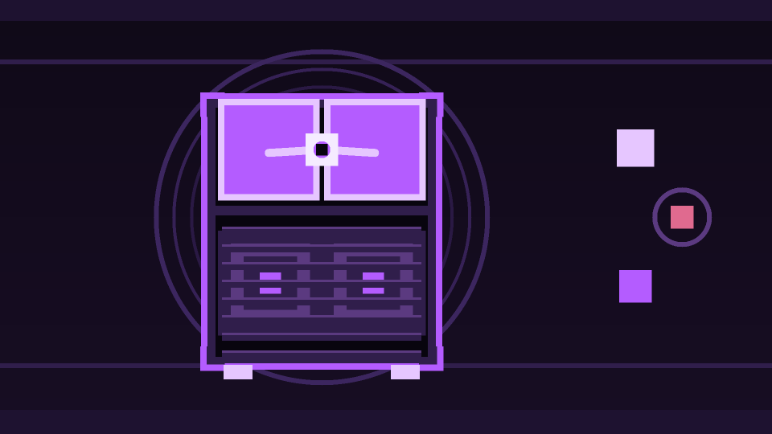

# OPEN B3



A tonewheel Hammond B3 for [VIBE FM](https://github.com/Vibe-FM-SDK/vibe-fm-sdk): a freestanding port of the OpenB3/setBfree Beatrix engine with three nine-drawbar manuals, scanner vibrato and chorus, key-click percussion, a driven preamp, algorithmic reverb and a full dual-rotor Leslie. It carries 24 classic presets, a four-slot mixer, eight generated grooves, eight chord stabs and a live 16-step display. Keys and MIDI play immediately; drums stay silent until you opt in. No samples, no impulse responses and no file access in the audio path.

The Beatrix allocator is served by a fixed 12 MiB static arena at init, with SDK maths primitives replacing libc. Control and audio run in two flows (`VIBE_PARALLEL_AUDIO`) connected by a small single-writer/single-reader command ring; the audio callback itself allocates nothing. Sample rate and block size always come from the host.

## Sound

- **91 generated tonewheels** with per-note taper, key compression and the Beatrix key-click/cosine/linear envelope models. No PCM tonewheel samples — the waveforms are built at startup.
- **Three manuals, 27 drawbar buses:** upper (MIDI ch 1), lower (ch 2) and pedal board (ch 3), each with nine 0–8 drawbars. Swell and master trim are continuous.
- **Scanner vibrato / chorus:** VIB 1–3 and CHORUS 1–3 from the original scanner circuit, with independent upper/lower assignment switches.
- **Percussion:** second-harmonic snap with fast/slow decay, soft/normal volume and first/second harmonic selection.
- **Preamp:** Beatrix overdrive with a clean-bypass switch, input drive and output level; the master fader is the last gain before the output stage.
- **Reverb:** seven-delay Schroeder-style room with allpass tail and a smoothed wet mix.
- **Leslie:** separate horn and bass rotors with acceleration/deceleration ramps, multiple reflection taps and a stereo microphone mix. Stop / slow / fast is one parameter on the FX page; MIDI CC 62 toggles between stop and slow.
- **Safety limiter:** a gentle `tanh` stage keeps even the hottest overdrive presets inside ±0.97.

## 24 presets

Power-on starts on **JAZZ**, so the instrument plays as soon as it loads. Hold SHIFT and turn A/B, or press SHIFT + ◀ / ▶, to browse; the name is shown in the top right of the display. The same list is available as the `preset` parameter for DAW automation and as buttons on the custom Editor page.

`JAZZ`, `JIMMY SMITH`, `GOSPEL`, `GREEN ONIONS`, `SOUL`, `FUNK`, `LATIN`, `GEORGIE FAME`, `BOOKER T`, `MOTOWN`, `BLUES`, `BALLAD`, `SHUFFLE`, `BOSSA NOVA`, `REGGAE`, `DISCO`, `ROCK`, `DIXIE`, `WORSHIP`, `FLUTE`, `BRASS`, `STRINGS`, `PERCUSSION`, `OVERDRIVE`.

Each preset carries its own drawbars, scanner/percussion settings, preamp, reverb, Leslie speed and groove. Knob changes stay live until you pick another preset. All parameter values are saved to `b3-state` on the host's SAVE; the drum run switch is deliberately never restored from saved state.

## Rhythm & chord stabs

- **Drums are opt-in.** Pads 1–8 start (or stop) a groove; PLAY / the DRUMS toggle and the pedal switch do the same. A DAW's PLAY only supplies tempo and beat position — it never starts the drum bus. This is covered by `wasmtest-drums-optin.json`.
- **Eight 16-step grooves:** `JAZZ RIDE`, `SHUFFLE`, `BOSSA`, `FUNK`, `GOSPEL`, `ROCK`, `LATIN`, `BALLAD`. The patterns are fixed C tables; the voices are synthesized (no samples).
- **Eight drum voices:** kick, snare, rim, closed hat, open hat, ride, tom and brush, with 12 fixed voices, per-voice pan and a single drum-level fader.
- **Chord stabs:** pads 9–16 fire major, minor, 7th, m7, maj7, sus4, dim and 6/9 stabs from the last played root. Stab length is adjustable on the SEQ page.
- Tempo (60–200 bpm) and swing (0–0.75) are live. When a host transport is running the sequencer follows its beat instead of the internal clock.

## Four-slot mixer

The FX page is also the mixer: **upper / lower / pedal / drums**, each with level, pan, mute, solo and arm. Solo on any slot mutes the others. The legacy `drum_level` parameter and the SDK `mix_4_level` are one fader, so older saved states and mixer controllers stay in sync. `mix_select` chooses the slot a mixer controller edits. ARM is reported for controller compatibility; this firmware has no recorder and arming never starts drums.

## Controls

| Control | Action |
|---|---|
| Keys / MIDI / DAW notes | Play the manuals (upper by default; MIDI ch 2 lower, ch 3 pedal) |
| SHIFT + A/B or ◀ / ▶ | Previous / next preset |
| Pads 1–8 | Start a groove; tap the running groove again to stop |
| Pads 9–16 | Play a chord stab from the last note |
| Encoder A / B | Select groove / chord |
| Encoders 1–4 | Edit the four values shown on the open page |
| F1–F6, K1–K6 | SOUND / LOWER / VIB / FX / RHY / SEQ (K2 is captioned DRAW) |
| MENU / ▶ / ◀ | Next / previous page |
| PLAY / STOP | Run / stop drums (only after opting in) |
| REC | Panic: all notes off, stabs and drums reset |
| HOME / RETURN | Controls overview / back to SOUND |
| DATA + ENTER | FOCUS: walk every on-screen control, turn to edit; clicks work too |
| Expression pedal / switch | Swell / toggle drums |
| MIDI CC 7 / 11 / 62 | Master / swell / rotary stop ↔ slow toggle |
| DAW Play | Tempo and beat sync only |
| OCT − / + | Host shifts the keyboard octave |

The standard Editor presents nine cards under six colour-coded tabs (PRESET, DRAWBARS, VIB PERC, FX, RHYTHM, MIX). The optional custom page adds 24 preset buttons, grouped sliders, groove status and a live device display. The firmware stays fully playable without it.

## Build

Requires Zig 0.13.0 on `PATH`, `sh`, Node.js (for validation) and Python 3 (for the icon and zip fallback).

```sh
# Build the WASM + ZIP from the repository root:
cd sdk
sh tools/build.sh ../firmware/b3
# -> build/b3.wasm, build/b3.zip, build/b3.json,
#    build/b3.png, build/b3.editor/
```

Regenerate the Leslie-menu tile:

```sh
python tools/make_icon.py
```

## Validate

```sh
node sdk/tools/vibe-check.mjs sdk/build/b3.wasm \
  --manifest firmware/b3/firmware.json --seconds 5

mkdir -p sdk/build/b3-test
node sdk/tools/wasmtest.mjs sdk/build/b3.wasm \
  firmware/b3/test/wasmtest.json sdk/build/b3-test

mkdir -p sdk/build/b3-presets
node sdk/tools/wasmtest.mjs sdk/build/b3.wasm \
  firmware/b3/test/wasmtest-presets.json sdk/build/b3-presets

mkdir -p sdk/build/b3-mixer
node sdk/tools/wasmtest.mjs sdk/build/b3.wasm \
  firmware/b3/test/wasmtest-mixer.json sdk/build/b3-mixer

mkdir -p sdk/build/b3-drums-optin
node sdk/tools/wasmtest.mjs sdk/build/b3.wasm \
  firmware/b3/test/wasmtest-drums-optin.json sdk/build/b3-drums-optin
```

Browser emulator: `python3 sdk/tools/emulator.py` → `http://127.0.0.1:8766`.

On Windows PowerShell, set `$env:HOME = $env:USERPROFILE` before running the Node tools and use `New-Item -ItemType Directory -Force` in place of `mkdir -p`.

## Deploy

Drop `sdk/build/b3.zip` onto the VIBE FM VST window in your DAW, or load `b3.wasm` in the SDK emulator / on VIBE FM hardware.

## Layout

```
firmware/b3/
  main.c                  parameters, presets, pages, pads, mixer, FOCUS, Editor bridge
  tonegen.c / .h          the Beatrix 91-wheel tone generator (three manuals, percussion, envelopes)
  vibrato.c / .h          scanner vibrato and chorus
  reverb.c / .h           seven-delay algorithmic reverb
  whirl.c / .h            dual-rotor Leslie with reflection taps and stereo mics
  overdrive.c / .h        preamp / overdrive transfer curve
  eqcomp.c / .h           biquad coefficient helpers
  b3_drums.c / .h         synthesized drum voices and eight 16-step grooves
  b3_compat.c / .h        freestanding libc shim, static arena, SDK-backed maths
  freestanding/           minimal libc headers for the freestanding build
  firmware.json           manifest (id: b3, protocol 7)
  editor/index.html       optional custom Editor page
  icon.png                960 x 540 menu tile (Leslie speaker)
  test/wasmtest.json                  sound, grooves, stabs, pages, HOME
  test/wasmtest-presets.json          preset recall regression
  test/wasmtest-mixer.json            four-slot fader regression
  test/wasmtest-drums-optin.json      DAW Play must not start drums
  LICENSE / NOTICE.txt    AGPL-3.0 and setBfree / OpenB3 GPL-2.0 notices
tools/make_icon.py        stdlib-only icon generator
sdk/                      vendored VIBE FM SDK (pinned commit)
```

## Credits & licence

The tone generator, scanner, reverb, Leslie and preamp are a freestanding port of the Beatrix C engine from [OpenB3](https://github.com/michele-perrone/OpenB3) by Michele Perrone (AGPL-3.0-or-later). Those DSP files originate from [setBfree](https://setbfree.org/) by Robin Gareus and contributors and remain GPL-2.0-or-later, with their original headers preserved. The VIBE FM front end, compatibility layer and rhythm engine are AGPL-3.0-or-later; the rhythm voices were adapted from keste's Apache-2.0 FUNKY-TRAIN drum code. See `firmware/b3/LICENSE` and `firmware/b3/NOTICE.txt`.

Built with the VIBE FM SDK (Apache-2.0, © 2026 Sven Trogus). "VIBE FM" is a trademark of its respective owner; this firmware is built with the VIBE FM SDK and is not affiliated with or endorsed by the trademark holder.
